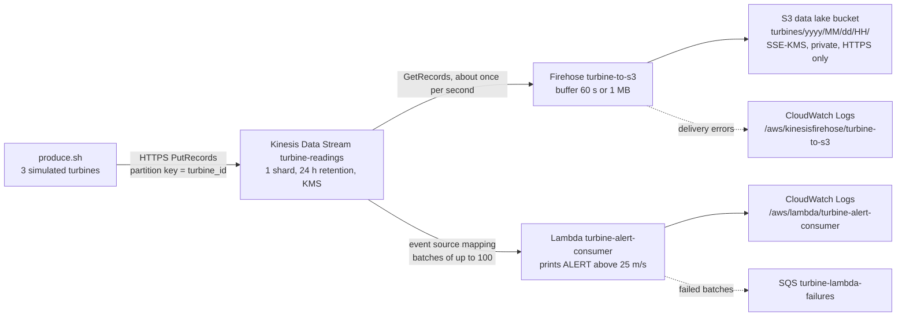

# Wind Turbine Streaming PoC (Kinesis + Firehose + Lambda + S3)

A small, realistic proof of concept built while studying for the **AWS Certified Solutions Architect – Associate** exam. It streams simulated wind turbine readings through **Amazon Kinesis Data Streams** to two independent consumers, inside a private, encrypted, hand-built network. The whole environment is one **CloudFormation** template.

The goal is learning, not production. The README explains what is built, why each piece exists, how to run it, what it costs, and where it deliberately cuts corners.

- Region: `eu-west-1` (Ireland)
- Everything is in one template: `template.yaml`
- Tagged `Project=turbine-poc`, so it is easy to find and delete

---

## 1. What it does

Three simulated turbines (`T1`, `T2`, `T3`) each send a reading every second:

```json
{"turbine_id":"T2","wind_speed":27.4,"temperature":9.1,"timestamp":"2026-10-21T09:27:13Z"}
```

Each record ends with a newline, so every reading lands on its own line in the S3 files.

The readings go into a Kinesis data stream, and **two consumers read the same data independently**:

| Consumer | Job | Latency |
|---|---|---|
| **Lambda** (`turbine-alert-consumer`) | Prints `ALERT` when `wind_speed > 25` m/s | Real time (seconds) |
| **Amazon Data Firehose** (`turbine-to-s3`) | Stores every reading in S3, in folders by date and hour | Near real time (buffers 60 s or 1 MB) |

## 2. Architecture



### Network layout

```
VPC 10.0.0.0/16        (no internet gateway, no NAT gateway)
├── AZ eu-west-1a   private subnet 10.0.1.0/24   Kinesis endpoint ENI, Lambda ENI
├── AZ eu-west-1b   private subnet 10.0.2.0/24   Kinesis endpoint ENI, Lambda ENI
└── private route table: "local" route + S3 prefix-list route to the S3 gateway endpoint
```

Kinesis, Firehose, S3, SQS and CloudWatch are regional managed services. They live **outside** the VPC and are reached through their AWS APIs.

## 3. What gets created

| Layer | Resource | Purpose |
|---|---|---|
| Network | `Vpc` | Private network `10.0.0.0/16`, DNS support and hostnames on (needed for private DNS on the endpoint) |
| | `PrivateSubnetA`, `PrivateSubnetB` | One subnet per Availability Zone, no public IPs |
| | `PrivateRouteTable` + 2 associations | Routing for both subnets. No route to the internet. |
| | `EndpointSecurityGroup` (`sg-endpoint`) | Accepts HTTPS (443) only from `sg-producer` and `sg-lambda` |
| | `ProducerSecurityGroup` (`sg-producer`) | May only send HTTPS (443) to `sg-endpoint` |
| | `LambdaSecurityGroup` (`sg-lambda`) | May only send HTTPS (443) to `sg-endpoint` |
| | `EndpointIngressFromProducer` / `FromLambda` | Separate ingress rules (avoids a circular dependency between security groups) |
| | `S3GatewayEndpoint` | Free private path to S3 through a route table entry. Its policy allows only our bucket. |
| | `KinesisInterfaceEndpoint` | PrivateLink: one ENI per subnet, private DNS, so `kinesis.eu-west-1.amazonaws.com` resolves to a private IP inside the VPC |
| Security | `DataKey` + `DataKeyAlias` | Customer-managed KMS key (`alias/turbine-poc`), yearly rotation, 7-day deletion window |
| Streaming | `TurbineStream` | Kinesis data stream, 1 shard, provisioned, 24 h retention, encrypted with `DataKey` |
| Storage | `DataLakeBucket` | S3 bucket: SSE-KMS with bucket key, Block Public Access, 30-day expiration |
| | `DataLakeBucketPolicy` | Denies any request that is not HTTPS (`aws:SecureTransport = false`) |
| Consumer 2 | `FirehoseRole` | Trust: Firehose only. Allows reading the stream, writing the bucket, using the key, writing logs. |
| | `FirehoseLogGroup` + `FirehoseLogStream` | Delivery error logs, 7-day retention |
| | `TurbineDeliveryStream` | Kinesis stream → S3, prefix `turbines/yyyy/MM/dd/HH/`, errors under `errors/` |
| Consumer 1 | `LambdaFailureQueue` | SQS queue that receives details of batches Lambda gave up on |
| | `LambdaRole` | Trust: Lambda only. VPC access (managed policy), read the stream, decrypt, send to the queue. |
| | `LambdaLogGroup` | Function logs, 7-day retention |
| | `TurbineAlertFunction` | Python 3.12, runs inside the VPC (both subnets, `sg-lambda`) |
| | `TurbineStreamMapping` | Event source mapping: starts at `TRIM_HORIZON`, 2 retries, bisects failing batches, on-failure goes to SQS |

## 4. How the pieces work

### Kinesis shards and partition keys
A **shard** is one lane of capacity: **1 MB/s or 1,000 records/s in** and **2 MB/s out**, with order guaranteed inside the shard. The producer chooses a **partition key** (here `turbine_id`); Kinesis hashes it to pick the shard, so all readings from one turbine stay in order. With one shard everything lands together, but the habit is the same. More throughput means more shards. A key with few distinct values causes a "hot shard".

### A stream is not a queue
| | Kinesis Data Streams | SQS |
|---|---|---|
| After a consumer reads a record | It stays until retention ends (24 h here) | The message is deleted |
| Several consumers, same data | Yes, each with its own bookmark | No, they compete for messages |
| Replay | Yes (`TRIM_HORIZON`, `AT_TIMESTAMP`) | No |
| Order | Per shard | Only FIFO queues |

The consumers do not receive data on a permanent connection. Producers send ordinary HTTPS requests (`PutRecords`), and consumers **poll** (`GetRecords`, about once per second per shard). Firehose and the Lambda event source mapping are exactly such loops, run for you by AWS. Standard consumers share the shard's 2 MB/s read limit; **enhanced fan-out** gives each consumer its own.

### Firehose and Data Streams
| | Data Streams | Firehose |
|---|---|---|
| Latency | Real time | Near real time (buffering) |
| Replay | Yes | No |
| Capacity | You manage shards | Automatic |
| Consumers | Your own code | Fixed destinations (S3, Redshift, OpenSearch, ...) |
| Code needed | Yes | No (optional Lambda transformation) |

Firehose adds **no newline** between records, which is why the producer appends one.

### Kinesis and SNS
SNS **pushes** a message to every subscriber and stores nothing, which suits alerts and notifications. Kinesis keeps an ordered log that consumers **pull** and can replay, which suits a continuous flow of data. They combine well: Kinesis → Lambda → SNS → email or SMS to the operator.

### Poison-pill protection
Lambda reads a shard in order. A batch that keeps failing would block everything behind it until the records expire. The mapping therefore retries twice, **bisects** the batch to isolate the bad record, ignores records older than one hour, and reports dropped batches to SQS. The report contains **metadata** (shard and sequence numbers), not the records, because the stream still holds them for replay.

### Encryption
- **At rest:** the KMS key encrypts the stream and the S3 objects. The key policy trusts the account (`:root`), so IAM policies decide who can use the key. A caller needs **both** the key policy to allow it and an IAM policy that grants the action.
- **In transit:** TLS (HTTPS). The bucket policy refuses plain HTTP.
- The KMS key does not encrypt traffic. TLS does.

### Private networking
The VPC has no internet route. Resources inside it reach AWS services through endpoints:
- **Gateway endpoint (S3, DynamoDB only):** a route table entry to an AWS-managed prefix list. Free. No DNS change.
- **Interface endpoint (PrivateLink):** ENIs with private IPs in your subnets and a security group. Billed per hour per AZ. With private DNS the normal service name resolves to the private IP, so code is unchanged.
- An endpoint **policy** only limits access; it never grants it.

**Honest note:** in this PoC nothing inside the VPC strictly needs the endpoints. The Lambda function only prints, its stream polling is done by the Lambda service outside the VPC, and Firehose is outside the VPC too. The endpoints, security groups and route table are built to practice the secure design. They would be used by anything inside the VPC that called Kinesis or S3 itself, for example a producer in a CloudShell VPC environment or an EC2 instance.

A public AWS service can never open a connection into your private VPC. The side that wants the data starts the connection (the resource inside pulls, or you publish a service through PrivateLink).

## 5. Prerequisites

- AWS CLI v2 and a profile named `poc` (this project used IAM Identity Center: `aws configure sso`, then `aws sso login --profile poc`)
- [`cfn-lint`](https://github.com/aws-cloudformation/cfn-lint) (`pip install cfn-lint`), optional but recommended
- Bash, `base64` and `date` (Linux)

```bash
export AWS_PROFILE=poc AWS_DEFAULT_REGION=eu-west-1
BUCKET=turbine-poc-lake-$(aws sts get-caller-identity --query Account --output text)-eu-west-1
```

## 6. Deploy

```bash
cfn-lint template.yaml

aws cloudformation deploy \
  --template-file template.yaml \
  --stack-name turbine-poc \
  --region eu-west-1 \
  --tags Project=turbine-poc \
  --capabilities CAPABILITY_IAM
```

`--capabilities CAPABILITY_IAM` is required because the template creates IAM roles. Creating the Lambda function inside a VPC takes about a minute longer than usual.

To preview changes without applying them, add `--no-execute-changeset`.

## 7. Run the simulation

```bash
chmod +x produce.sh
./produce.sh
```

It sends 3 readings per second for about 2 minutes (360 records) with one `PutRecords` call per second, and prints `failed: N` after each call. About 16% of the readings exceed 25 m/s (wind speeds range from 5.0 to 28.9).

## 8. Verify

**Lambda alerts (real time):**
```bash
aws logs filter-log-events --log-group-name /aws/lambda/turbine-alert-consumer \
  --filter-pattern ALERT --query 'events[].message' --output text | head
aws logs filter-log-events --log-group-name /aws/lambda/turbine-alert-consumer \
  --filter-pattern ALERT --query 'length(events)'
```

**Firehose files in S3 (near real time).** The folder and file name use UTC arrival time:
```bash
aws s3 ls s3://$BUCKET/turbines/ --recursive --human-readable
aws s3 sync s3://$BUCKET/turbines ./lake
find ./lake -type f | xargs cat | wc -l      # about 360 lines
```

**Event source mapping:**
```bash
aws lambda list-event-source-mappings --function-name turbine-alert-consumer \
  --query 'EventSourceMappings[].{State:State,LastResult:LastProcessingResult}'
```
`No records processed` is normal right after creation. It becomes `OK` after the first poll.

**Replay from the start of the stream** (records stay for 24 h even though both consumers already read them):
```bash
SHARD=$(aws kinesis list-shards --stream-name turbine-readings --query 'Shards[0].ShardId' --output text)
IT=$(aws kinesis get-shard-iterator --stream-name turbine-readings --shard-id $SHARD \
     --shard-iterator-type TRIM_HORIZON --query ShardIterator --output text)
aws kinesis get-records --shard-iterator $IT --limit 3 --query 'Records[].Data' --output text \
  | tr '\t' '\n' | while read d; do echo "$d" | base64 -d; done
```
The console equivalent is Kinesis → Data streams → `turbine-readings` → **Data viewer**, starting position **Trim horizon**.

**Test the Lambda by hand** with a fake Kinesis event:
```bash
DATA=$(printf '{"turbine_id":"T9","wind_speed":31.2,"temperature":5.0,"timestamp":"2026-10-21T10:00:00Z"}\n' | base64 -w0)
aws lambda invoke --function-name turbine-alert-consumer --cli-binary-format raw-in-base64-out \
  --payload "{\"Records\":[{\"kinesis\":{\"data\":\"$DATA\"}}]}" out.json
aws logs tail /aws/lambda/turbine-alert-consumer --since 5m
```

## 9. Experiments to try

- **Late consumer:** deploy the event source mapping after running the producer. Because it starts at `TRIM_HORIZON`, Lambda still processes every record the stream kept.
- **Bad record:** send a record that is not JSON. Watch Lambda retry, bisect, and finally report to the `turbine-lambda-failures` queue.
- **Pause and resume:** disable the event source mapping, send more data, then re-enable it. Lambda resumes from its bookmark.
- **Throttling:** send more than 1 MB/s to the single shard and watch `ProvisionedThroughputExceededException`.

## 10. Cost

Approximate, `eu-west-1`, check current pricing. If the stack is left running, expect roughly **1 USD per day**.

| Item | Approximate cost |
|---|---|
| Kinesis shard | about 0.015 USD per hour (about 0.36 USD per day) |
| Kinesis interface endpoint | about 0.011 USD per hour per AZ (2 AZs) |
| KMS customer-managed key | about 1 USD per month |
| Firehose, Lambda, SQS, S3, CloudWatch Logs | cents at this volume |
| S3 gateway endpoint, VPC, subnets, route tables, security groups, IAM | free |

**Delete the stack when you are done.**

## 11. Clean up

```bash
aws s3 rm s3://$BUCKET --recursive          # CloudFormation cannot delete a bucket that still has objects
aws cloudformation delete-stack --stack-name turbine-poc --region eu-west-1
aws cloudformation wait stack-delete-complete --stack-name turbine-poc --region eu-west-1
aws cloudformation describe-stacks --stack-name turbine-poc --region eu-west-1   # should fail: does not exist
```

Deleting can take several minutes, because Lambda's network interfaces are cleaned up before the subnets can be removed. The KMS key is scheduled for deletion after the 7-day window. Remove the local `lake/` folder and `out.json` if you created them.

## 12. Troubleshooting (problems met while building it)

| Symptom | Cause and fix |
|---|---|
| `AWS::EarlyValidation::PropertyValidation` when creating the change set | A typo in a property name or a wrongly indented list (for example a split `Tags` list). Run `cfn-lint`, and check the exact property spelling. |
| `InsufficientCapabilitiesException: Requires capabilities : [CAPABILITY_IAM]` | Add `--capabilities CAPABILITY_IAM` to the deploy command |
| `FirehoseRole CREATE_FAILED: Syntax errors in policy` | A policy statement is incomplete or malformed (for example a statement with only `Sid`). Check `Effect`, `Action`, `Resource` and `Version: '2012-10-17'`. |
| Firehose "unable to assume role" | IAM changes can take a moment to spread. Wait 30 seconds and redeploy. |
| Only the manual test appears in the Lambda logs | The event source mapping is missing from the stack, or it is still in `No records processed`. Check `list-event-source-mappings`. |
| Duplicate resource names in the template | YAML silently keeps the last one. `cfn-lint` flags it. Edit a resource instead of pasting a second copy. |
| Stack failed during an update | The update rolls back automatically (`UPDATE_ROLLBACK_COMPLETE`). Find the first failed event with `describe-stack-events`, fix it, and redeploy. |

## 13. Well-Architected Framework mapping

Based on the AWS Well-Architected Framework whitepaper (October 20, 2022 edition; page numbers refer to that PDF).

| Pillar and question | Where it shows up |
|---|---|
| **Security: SEC05-BP01 Create network layers** (p. 155) | Private subnets in two AZs with no route to or from the internet |
| **Security: SEC05-BP02 Control traffic at all layers** (p. 156) | Route table, stateful security groups that reference each other, endpoint policy, PrivateLink |
| **Security: SEC03-BP02 Grant least privilege access** | Roles scoped to specific ARNs. Separate roles for Firehose and Lambda. |
| **Security: SEC08-BP01 Implement secure key management** (p. 168) | Customer-managed KMS key with rotation and a key policy |
| **Security: SEC08-BP02 Enforce encryption at rest** (p. 169) | Stream encryption and S3 default encryption with the KMS key |
| **Security: SEC08-BP04 Enforce access control** (p. 170) | S3 Block Public Access, least-privilege key use |
| **Security: SEC09-BP02 Enforce encryption in transit** | HTTPS-only bucket policy, TLS between all components |
| **Security: SEC02-BP02 Use temporary credentials** | IAM Identity Center with MFA and short-term credentials, IAM roles for services |
| **Reliability: REL 11 Withstand component failures** (p. 255) | Retries, batch bisection, record age limit, SQS failure destination |
| **Reliability: REL10-BP04 Use bulkhead architectures** (pp. 254-255) | Shards and partition keys as data bulkheads |
| **Operational excellence: OPS08 Workload observability** | Lambda and Firehose logs with retention |
| **Cost optimization** | Managed services, 30-day S3 expiration, 7-day log retention, `delete the stack` habit |

## 14. Known simplifications

These are accepted departures from production practice, kept to hold down complexity:

- The `PoC-Admin` permission set uses **AdministratorAccess** (4 h sessions, MFA). The framework recommends least privilege for people as well.
- The KMS key policy has **one statement** for administration and use. Production keys should separate **key administrators** from **key users** (SEC08-BP01).
- The Lambda role uses the AWS-managed `AWSLambdaVPCAccessExecutionRole`, which uses `Resource: "*"` for network interface actions, and `kinesis:ListStreams` cannot be scoped to one resource.
- **No S3 versioning** (a real data lake would have it), and **no CloudWatch alarms**, stack **Outputs**, or VPC Flow Logs.
- Log groups use the default CloudWatch encryption, not the customer-managed key.
- The S3 bucket has no `aws:SourceVpce` restriction, so Firehose and your own CLI can still reach it.
- The Lambda sits in the VPC for practice. Its work does not need it (see the honest note in section 4).
- The Kinesis stream is **provisioned** with one shard. Use on-demand mode for unpredictable traffic.
- Producer runs from a laptop through the public Kinesis endpoint, not through the VPC endpoint.

## 15. Ideas for next branches

- Amazon **Athena** + **AWS Glue** Data Catalog to query the S3 files with SQL (the newline-separated JSON is ready for it)
- **GZIP / Parquet** conversion in Firehose
- **CloudWatch alarms** (iterator age, Lambda errors, Firehose delivery errors) and stack Outputs
- **SNS** topic so the Lambda emails or texts the operator on an alert
- **DynamoDB** as a "latest state per turbine" hot path
- **Enhanced fan-out** consumer, or a **Managed Service for Apache Flink** application for windowed averages
- **AWS IoT Core** (MQTT) as the real device entry point
- Run the producer from a **CloudShell VPC environment** with `sg-producer`, to send data through the interface endpoint
- A **NACL** on the subnets, and a NAT gateway vs endpoint cost comparison
- Separate key administrator and key user statements in the key policy

## 16. Exam cheat sheet from this PoC

- Real-time stream, replay, ordering per key, several consumers → **Kinesis Data Streams**
- Load streaming data into S3/Redshift/OpenSearch with no code → **Firehose**
- Windows and aggregations over a stream → **Managed Service for Apache Flink**
- Notify people, fan out an event → **SNS**. Hand out jobs → **SQS**.
- Per shard: **1 MB/s or 1,000 records/s in, 2 MB/s out**. `ProvisionedThroughputExceeded` → add shards or fix a hot partition key.
- Many consumers throttling each other's reads → **enhanced fan-out**
- Private subnet needs S3 or DynamoDB → **gateway endpoint**. Another AWS API without internet → **interface endpoint (PrivateLink)**. Outbound-only internet → **NAT gateway**.
- Control and audit encryption keys → **customer-managed KMS key**. Key policy first, IAM second.
- Force HTTPS on S3 → bucket policy denying `aws:SecureTransport = false`
- Lambda in a VPC loses internet access unless there is a NAT gateway
- Kinesis → Lambda stuck on a bad record → retries, bisect batch, on-failure destination
